<picture>
  <source media="(prefers-color-scheme: dark)" srcset="assets/header-dark.svg">
  <source media="(prefers-color-scheme: light)" srcset="assets/header-light.svg">
  
</picture>

<picture>
  <source media="(prefers-color-scheme: dark)" srcset="assets/typing-dark.svg">
  <source media="(prefers-color-scheme: light)" srcset="assets/typing-light.svg">
  
</picture>

  I build AI that does real work: agents, automations and the self-hosted stack they run on. 
  Mostly fintech and crypto, mostly on hardware I own. 
  If I do it twice, I script it. The third time, an agent does it.

<picture>
  <source media="(prefers-color-scheme: dark)" srcset="assets/whoami-dark.svg">
  <source media="(prefers-color-scheme: light)" srcset="assets/whoami-light.svg">
  
</picture>

<picture>
  <source media="(prefers-color-scheme: dark)" srcset="assets/divider-dark.svg">
  <source media="(prefers-color-scheme: light)" srcset="assets/divider-light.svg">
  
</picture>

## > ls ~/work

<picture>
  <source media="(prefers-color-scheme: dark)" srcset="assets/work-dark.svg">
  <source media="(prefers-color-scheme: light)" srcset="assets/work-light.svg">
  
</picture>

## > cat pipeline.sh

<picture>
  <source media="(prefers-color-scheme: dark)" srcset="assets/pipeline-dark.svg">
  <source media="(prefers-color-scheme: light)" srcset="assets/pipeline-light.svg">
  
</picture>

<picture>
  <source media="(prefers-color-scheme: dark)" srcset="assets/divider-dark.svg">
  <source media="(prefers-color-scheme: light)" srcset="assets/divider-light.svg">
  
</picture>

## > ls ~/projects

<a href="https://github.com/xc4pr/roomx">
  <picture>
    <source media="(prefers-color-scheme: dark)" srcset="assets/roomx-dark.svg">
    <source media="(prefers-color-scheme: light)" srcset="assets/roomx-light.svg">
    
  </picture>
</a>

  <a href="https://github.com/xc4pr/roomx"><b>repo</b></a> &nbsp;·&nbsp; <a href="https://xc4pr.github.io/roomx/"><b>open the app</b></a>

<picture>
  <source media="(prefers-color-scheme: dark)" srcset="assets/artcraft-dark.svg">
  <source media="(prefers-color-scheme: light)" srcset="assets/artcraft-light.svg">
  
</picture>

  <a href="https://github.com/storytold/deckcraft/pulls?q=is%3Apr+author%3Axc4pr"><b>DeckCraft PRs</b></a> &nbsp;·&nbsp; <a href="https://github.com/storytold/gridcraft/pulls?q=is%3Apr+author%3Axc4pr"><b>GridCraft PRs</b></a>

<picture>
  <source media="(prefers-color-scheme: dark)" srcset="assets/lab-dark.svg">
  <source media="(prefers-color-scheme: light)" srcset="assets/lab-light.svg">
  
</picture>

<picture>
  <source media="(prefers-color-scheme: dark)" srcset="assets/divider-dark.svg">
  <source media="(prefers-color-scheme: light)" srcset="assets/divider-light.svg">
  
</picture>

## > cat interests.txt

<picture>
  <source media="(prefers-color-scheme: dark)" srcset="assets/interests-dark.svg">
  <source media="(prefers-color-scheme: light)" srcset="assets/interests-light.svg">
  
</picture>

## > pacman -Qe

  <picture>
    <source media="(prefers-color-scheme: dark)" srcset="https://skillicons.dev/icons?i=arch%2Cubuntu%2Ckali%2Clinux%2Cbash%2Cpy%2Crust%2Ccs%2Cdotnet%2Cts%2Cjs%2Chtml%2Ccss%2Csvelte%2Cfastapi%2Cpostgres%2Cdocker%2Cgit%2Cvscode%2Cobsidian&amp;theme=dark&amp;perline=10">
    <source media="(prefers-color-scheme: light)" srcset="https://skillicons.dev/icons?i=arch%2Cubuntu%2Ckali%2Clinux%2Cbash%2Cpy%2Crust%2Ccs%2Cdotnet%2Cts%2Cjs%2Chtml%2Ccss%2Csvelte%2Cfastapi%2Cpostgres%2Cdocker%2Cgit%2Cvscode%2Cobsidian&amp;theme=light&amp;perline=10">
    
  </picture>

  <picture>
    <source media="(prefers-color-scheme: dark)" srcset="https://img.shields.io/badge/Ollama-12122a?style=for-the-badge&amp;logo=ollama&amp;logoColor=00f0ff">
    <source media="(prefers-color-scheme: light)" srcset="https://img.shields.io/badge/Ollama-e9f6fb?style=for-the-badge&amp;logo=ollama&amp;logoColor=007f9c">
    
  </picture>
  <picture>
    <source media="(prefers-color-scheme: dark)" srcset="https://img.shields.io/badge/ROCm-12122a?style=for-the-badge&amp;logo=amd&amp;logoColor=ff2bd6">
    <source media="(prefers-color-scheme: light)" srcset="https://img.shields.io/badge/ROCm-e9f6fb?style=for-the-badge&amp;logo=amd&amp;logoColor=b0128c">
    
  </picture>
  <picture>
    <source media="(prefers-color-scheme: dark)" srcset="https://img.shields.io/badge/systemd-12122a?style=for-the-badge">
    <source media="(prefers-color-scheme: light)" srcset="https://img.shields.io/badge/systemd-e9f6fb?style=for-the-badge">
    
  </picture>
  <picture>
    <source media="(prefers-color-scheme: dark)" srcset="https://img.shields.io/badge/Playwright-12122a?style=for-the-badge">
    <source media="(prefers-color-scheme: light)" srcset="https://img.shields.io/badge/Playwright-e9f6fb?style=for-the-badge">
    
  </picture>

<picture>
  <source media="(prefers-color-scheme: dark)" srcset="assets/divider-dark.svg">
  <source media="(prefers-color-scheme: light)" srcset="assets/divider-light.svg">
  
</picture>

<picture>
  <source media="(prefers-color-scheme: dark)" srcset="https://raw.githubusercontent.com/xc4pr/xc4pr/output/assets/upstream-dark.svg">
  <source media="(prefers-color-scheme: light)" srcset="https://raw.githubusercontent.com/xc4pr/xc4pr/output/assets/upstream-light.svg">
  
</picture>

## > watch -n 86400 contributions

<picture>
  <source media="(prefers-color-scheme: dark)" srcset="https://raw.githubusercontent.com/xc4pr/xc4pr/output/assets/contrib3d-dark.svg">
  <source media="(prefers-color-scheme: light)" srcset="https://raw.githubusercontent.com/xc4pr/xc4pr/output/assets/contrib3d-light.svg">
  
</picture>

<picture>
  <source media="(prefers-color-scheme: dark)" srcset="https://raw.githubusercontent.com/xc4pr/xc4pr/output/assets/snake-dark.svg">
  <source media="(prefers-color-scheme: light)" srcset="https://raw.githubusercontent.com/xc4pr/xc4pr/output/assets/snake-light.svg">
  
</picture>

<picture>
  <source media="(prefers-color-scheme: dark)" srcset="assets/footer-dark.svg">
  <source media="(prefers-color-scheme: light)" srcset="assets/footer-light.svg">
  
</picture>
